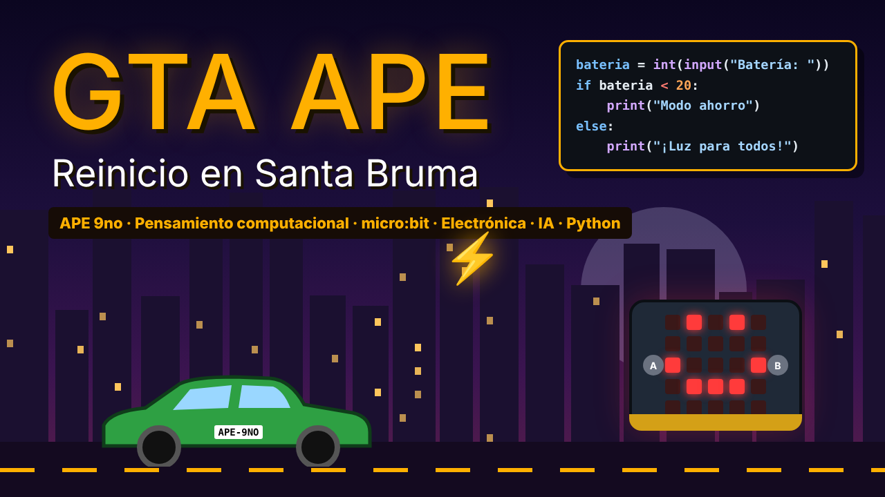

<p align="center">
  
</p>

<h1 align="center">GTA APE: Reinicio en Santa Bruma</h1>

<p align="center"><strong>SHANUKI</strong></p>

<p align="center"><strong>Acompañamiento Pedagógico Específico (APE) de 9no — Ciencias de la Computación, en forma de juego de mundo abierto.</strong></p>

---

## ¿Qué es?

Un juego retro de vista superior que corre en el navegador. El estudiante es **Byte**, una estudiante de 9no que está haciendo su APE. Santa Bruma sufrió un apagón y **NÚCLEO**, el sistema central de la ciudad, se reinició sin memoria. Byte maneja por la ciudad, cumple misiones con la **Cuadrilla de Reinicio** y, en cada una, vuelve a enseñarle a NÚCLEO (y repasa) un contenido del curso.

Es la misma mecánica que [GTA SQL](https://shana2222.github.io/gta-sql/), con un cambio central pensado para el APE: **cada contenido se explica antes de proponer la actividad**.

## Cómo está organizada cada misión (enfoque APE)

| Paso | Qué ve el estudiante | Para qué sirve en el APE |
|---|---|---|
| 🎯 **Metas de aprendizaje** | 3 metas escritas en primera persona ("Reconozco…", "Uso…", "Escribo…") | Compartir con el estudiante metas claras de la selección priorizada |
| 📖 **Explicación** | 4 o 5 pantallas cortas (una idea por pantalla) con ejemplos, y tarjetas de repaso que giran | Volver a trabajar el aprendizaje pendiente antes de evaluar |
| 🎯 **3 actividades** | Se habilitan recién después de ver la explicación. Siempre hay un botón **📖 Volver a la explicación** | Práctica con retroalimentación inmediata que indica **dónde revisar** y nunca muestra la solución |
| 🪞 **Reflexión** | Pregunta abierta + autoevaluación (🟢 Lo logré · 🟡 Casi · 🔴 Necesito ayuda) | Evidencia y reflexión para el portafolio |

Al tercer intento fallido, la actividad sugiere volver a la explicación.

## Los contenidos (según el portafolio del curso)

| Misión | Contenido | Actividades |
|---|---|---|
| 1. Pensar como programador | Pensamiento computacional y las 4 fases de Polya | Ordenar las fases · Clasificar acciones por fase · Desafío tipo Bebras |
| 2. El proceso computacional | Entrada → Proceso → Salida, algoritmo, secuencia/condición/repetición | Clasificar E/P/S · Ordenar un algoritmo · Identificar estructuras |
| 3. La placa micro:bit | Placas programables: entradas, salidas, coordenadas de la matriz, eventos | 🟩 **Simulador**: explorar la placa usando sus entradas · programar una flecha con `led.plot` · programar un dado al sacudir |
| 4. Periféricos y corriente | Periféricos E/S, conexiones (USB, HDMI, Bluetooth, pines), voltaje/corriente/resistencia, ley de Ohm | Clasificar periféricos · 🔌 **Simulador**: conectar cada dispositivo en su conector · ⚡ **Laboratorio de corriente** con amperímetro |
| 5. Encender un LED | Componentes, polaridad del LED, protoboard, LED en un pin de la micro:bit (Tinkercad) | 🔧 **Simulador**: cablear pila, interruptor, resistencia y LED · armar en una **protoboard** · programar el parpadeo del LED en el pin 0 |
| 6. Entrenar una IA | IA, Machine Learning, etapas (clases, datos, etiquetas, entrenamiento, prueba) y sesgo | Ordenar etapas · Entrenar un clasificador de frutas · Detectar el sesgo |
| 7. Python: primeros pasos | Lenguaje de programación, `print()`, tipos de datos | Programa con `print` · Clasificar tipos · Predecir la salida |
| 8. Variables y entrada | Variables, `input()`, `int()`, `float()`, `str()` | Saludo personalizado · Arreglar el `TypeError` · Ticket del carrito de chivitos |
| 9. Funciones de texto y math | `len`, `upper`, `title`, `strip`, `round`, `import math` | Predecir la salida · Limpiar la pista del misterio · Área de la fuente |
| 10. Decisiones | `if / else`, `if / elif / else`, flujo de decisiones | Batería del semáforo · Clasificar la nota · **Tu historia interactiva** |

Son **30 actividades**. La nota del reporte es **(actividades logradas ÷ 30) × 10**.

### Misiones nerds (bonus, no cambian la nota)

| Centro | Personaje | Retos |
|---|---|---|
| 🤖 ITI | Profe Ohm | Carita en la matriz de LED · Termómetro con el botón B (simulador) |
| 💻 Ceibal | Tecla | ¿Es IA o no? · Datos de prueba |
| 📚 Liceo 29 | Profe Ada | Préstamo de la biblioteca (`if`) · Iniciales (`[0]` y `upper`) |
| 🔐 INET | Profe Bit | Circuito abierto o cerrado · Ley de Ohm (desafío) |
| 🏛️ Palacio Legislativo | Delia | Ordenar el algoritmo de una ley · Patrones |

En el Palacio Legislativo aparece **Pepe Mujica como homenaje** (presidente de Uruguay entre 2010 y 2015). La escena aclara que sus diálogos son ficticios.

Además está el **Cuartel del Hacker** (CASA-13): una **práctica libre de Python** que no cambia la nota, y los **mini retos de la calle** (❗ en el minimapa).

## Para docentes

### Marcar las misiones prioritarias de cada estudiante

El APE trabaja sobre una **selección priorizada**. Agrega `?prioridad=` al enlace con los números de misión (se pueden usar rangos):

```
https://<usuario>.github.io/gta-ape/?prioridad=1,7-10
```

Las misiones marcadas aparecen con ⭐ en el índice de contenidos, en el reporte y en el PDF. La elección queda guardada en el navegador del estudiante.

### Entrar directo a un contenido

El botón **APE** del HUD (y **🗺 Contenidos** en el menú de pausa) abre el índice: el estudiante puede ir directo al contenido que necesita, sin seguir la historia. El avance es el mismo en los dos caminos.

### Evidencias y portafolio

El chip **📊 Nota** o el botón **📄 Mi reporte** abren el reporte. Con **⬇ Descargar PDF (portafolio)** el estudiante baja un PDF para subir a CREA. Cada descarga es una **entrega numerada** con código. El PDF incluye:

- nota y avance por área (pensamiento computacional, placas y electrónica, IA, Python);
- misiones prioritarias;
- novedades desde la entrega anterior;
- cada misión con sus actividades, fechas y **autoevaluación**;
- las **reflexiones** escritas por el estudiante;
- el **código Python** de las actividades logradas (evidencia);
- bonus, insignias e historial de entregas.

Todo se guarda **en el navegador del estudiante** (`localStorage`). No hay servidor ni cuentas. Si cambia de computadora o borra los datos del navegador, empieza de cero. Este juego usa claves propias (`gtaape.*`), así que no pisa el progreso del GTA SQL aunque estén publicados en el mismo GitHub.

## Simuladores de placas y circuitos

En las misiones 3, 4 y 5 la práctica se hace **dentro de un simulador**: el estudiante programa, conecta o arma algo y ve el resultado.

| Simulador | Qué hace el estudiante | Cómo se verifica |
|---|---|---|
| 🟩 **micro:bit** | Escribe el programa en el Python de MakeCode, lo carga en una placa simulada y la usa con los botones A y B, **sacudir** y un **termómetro** deslizable. Tiene un LED externo en el pin 0 | Se prueba el programa en una placa de prueba: se aprietan botones, se sacude, se cambia la temperatura y se mira la matriz y el pin |
| 🔌 **Conectores** | Conecta teclado, televisor, auriculares, micro:bit y LED en USB, HDMI, Bluetooth o pines | Cada dispositivo "funciona" al quedar en su conector |
| ⚡ **Laboratorio de corriente** | Cambia la pila (1,5, 3 o 9 V) y la resistencia, y mira el amperímetro, la fórmula `I = (V − 2) ÷ R` y el brillo del LED | Explorar 4 combinaciones y dejar el LED entre 10 y 20 mA con 9 V |
| 🔧 **Cableado** | Tiende cables entre la pila, el interruptor, la resistencia y el LED | Un solucionador de circuitos detecta circuito abierto, cortocircuito, LED al revés, LED quemado o LED encendido, y pide que el interruptor lo apague |
| 🧩 **Protoboard** | Pincha la resistencia y un cable en una protoboard; al pasar por un agujero se iluminan los que están conectados | El mismo solucionador, con las reglas reales de la protoboard (columnas de 5 y rieles) |

El simulador de micro:bit soporta `basic` (`show_icon`, `show_number`, `show_string`, `clear_screen`, `pause`, `forever`), `led` (`plot`, `unplot`, `toggle`, `point`), `input` (`on_button_pressed`, `on_gesture`, `button_is_pressed`, `temperature`, `light_level`), `pins` (`digital_write_pin`, `analog_write_pin`, `digital_read_pin`), `randint` y funciones con `def`, `global` y `return`. Si falta `global` dentro de un evento, aparece el error real de Python (`UnboundLocalError`) con una pista.

## Python dentro del juego

Las actividades de Python usan un **intérprete propio y liviano** (`src/ape/python-mini.js`): no descarga nada, funciona sin internet y anda bien en las ceibalitas. Cubre lo que se trabaja en 9no:

- `print` (con `sep` y `end`), `input`, variables, `int`, `float`, `str`, `bool`, `type`;
- operaciones `+ - * / // % **`, comparaciones, `and`, `or`, `not`, `in`;
- textos: `len`, `upper`, `lower`, `title`, `capitalize`, `strip`, `replace`, `count`, `find`, `split`, `join`, índices `[0]`, recortes `[0:3]`, f-strings con formato (`{x:.2f}`);
- `round`, `abs`, `max`, `min`, `import math` (`sqrt`, `pi`, `floor`, `ceil`, `pow`), `import random` (`randint`, `choice`);
- `if / elif / else`, `while`, `for … in range()`, `break`, `continue`, funciones con `def`, `return` y `global`.

Los errores imitan los mensajes reales de Python 3 (`NameError`, `TypeError`, `ValueError`, `SyntaxError`, `IndentationError`…) y cada uno trae una **pista corta en español**. Los bucles infinitos se cortan a los 20.000 pasos. No incluye diccionarios ni clases.

La verificación prueba el programa con **varias entradas distintas** y revisa la lógica, no el texto exacto: mayúsculas, tildes y espacios no hacen fallar la actividad.

## Cómo publicarlo con GitHub Pages

1. Crea un repositorio (por ejemplo `gta-ape`) y sube todos los archivos de esta carpeta.
2. En el repositorio: **Settings → Pages**.
3. En *Source* elige **Deploy from a branch**, rama `main`, carpeta `/ (root)`.
4. Guarda. En un par de minutos queda en `https://<usuario>.github.io/gta-ape/`.

## Correrlo en la computadora

El juego usa módulos de JavaScript, así que hay que servir la carpeta por HTTP (no abrir el `index.html` con doble clic):

```bash
python3 -m http.server 8080
```

Después abre `http://localhost:8080`.

Pruebas automáticas (motor del juego + intérprete de Python + verificación de todas las actividades con soluciones correctas e incorrectas + historia completa):

```bash
node --test tests/*.test.js
```

## Dónde está cada cosa

| Archivo | Qué tiene |
|---|---|
| `src/ape/content.js` | Las 10 misiones: metas, explicaciones, tarjetas, actividades, reflexiones y los retos bonus |
| `src/ape/ape-console.js` | La pantalla de cada misión, el índice de contenidos, el reporte y los mini retos de la calle |
| `src/ape/python-mini.js` | El intérprete de Python |
| `src/ape/microbit-sim.js` | La micro:bit simulada (API de MakeCode, íconos y letras de la matriz) |
| `src/ape/circuit-sim.js` | El solucionador de circuitos y las reglas de la protoboard |
| `src/ape/sim-ui.js` | La pantalla de los simuladores |
| `src/ape/pdf-report.js` | El PDF de portafolio (jsPDF desde cdnjs) |
| `story/` | La historia en Markdown: misiones, personajes, objetos y mapa. La directiva `- APE: mision-N` abre la misión N |

## Créditos

**Recurso educativo del proyecto SHANUKI** para las clases de Ciencias de la Computación de 9no (Plan Ceibal, Uruguay).

El motor del juego (ciudad, tránsito, física, escenas, inventario) es el proyecto de código abierto **GTA — Guanabara Testando Agentes**, creado por Gustavo Guanabara ([Curso em Vídeo](https://www.youtube.com/cursoemvideo)), adaptado primero para **GTA SQL** y ahora para este APE.
